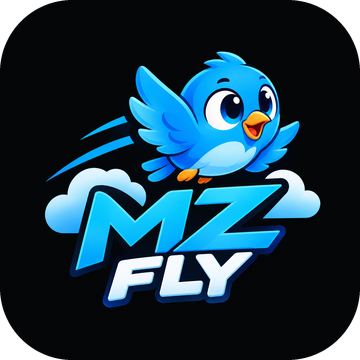

<p align="center">
  
</p>

<h1 align="center">MZ Fly</h1>

<p align="center">
  <strong>Game Arcade 2D Kartun Klasik Satu Sentuhan</strong><br>
  Dibangun dengan <strong>Flutter</strong> & <strong>Flame Game Engine</strong>.
</p>

<p align="center">
  
  
  
  
</p>

---

## 📖 Tentang MZ Fly

**MZ Fly** adalah game arcade kasual 2D yang seru dan menguji ketangkasan. Pemain mengontrol karakter burung kartun menggemaskan dengan mengetuk layar untuk mengepakkan sayap ke atas, menghindari gravitasi, dan meluncur melewati celah pipa rintangan untuk meraih skor tertinggi.

---

## ✨ Fitur Utama

- 🎮 **Kontrol Satu Sentuhan (*One-Touch*)**: Cukup ketuk layar untuk terbang dan melintasi rintangan.
- 🎨 **Visual Kartun Menawan**:
  - Karakter burung dengan animasi kepakan sayap dinamis, kedipan mata, dan ekspresi lucu.
  - Efek partikel asap (*puff particle*) saat mengepak dan bintang saat mencetak skor.
  - Latar belakang bertingkat (*multi-layer parallax*) dengan matahari, awan melayang, serta perbukitan hijau.
- 🏆 **Penyimpanan Skor Terbaik**: Rekor skor tersimpan otomatis secara offline menggunakan `shared_preferences`.
- 🥇 **Sistem Medali Pencapaian**: Raih medali *Bronze*, *Silver*, *Gold*, hingga *Platinum* berdasarkan skor yang diperoleh.
- 🎵 **Audio & Musik Latar (BGM & SFX)**: Efek suara interaktif (*flap*, *score*, *hit*, *game over*) dan musik latar ceria dengan tombol toggle SFX & BGM.
- ⏸️ **Menu Pause & Layar Game Over Rapi**: Navigasi intuitif untuk melanjutkan game, mengulang, atau kembali ke menu utama.

---

## 🛠️ Teknologi yang Digunakan

| Komponen | Deskripsi |
|---|---|
| **Framework** | [Flutter](https://flutter.dev) |
| **Game Engine** | [Flame Engine](https://flame-engine.org) |
| **Audio** | `flame_audio` |
| **Local Storage** | `shared_preferences` |
| **Typography** | Font Poppins (Extra Bold & Black) |

---

## 🚀 Cara Menjalankan

### Prasyarat
- [Flutter SDK](https://docs.flutter.dev/get-started/install) (versi 3.13 atau yang lebih baru)
- Perangkat Android / Emulator / Google Chrome

### Langkah Instalasi
1. **Clone repositori**:
   ```bash
   git clone https://github.com/mizanyf/MZFly.git
   cd MZFly
   ```

2. **Pasang dependensi**:
   ```bash
   flutter pub get
   ```

3. **Jalankan aplikasi**:
   - Di Web (Chrome):
     ```bash
     flutter run -d chrome
     ```
   - Di Android:
     ```bash
     flutter run -d android
     ```

4. **Menjalankan Unit & Widget Test**:
   ```bash
   flutter test
   ```

---

## 📂 Struktur Direktori Ringkas

```text
mzfly/
├── assets/
│   ├── audio/          # Efek suara (sfx) dan musik latar (bgm)
│   ├── fonts/          # Font Poppins
│   └── images/         # Logo aplikasi & aset visual
├── lib/
│   ├── game/
│   │   ├── components/ # BirdPlayer, ObstaclePair, Ground, Background
│   │   └── mz_fly_game.dart
│   ├── screens/        # GameScreen (Host GameWidget & UI overlays)
│   ├── services/       # AudioService & StorageService
│   ├── widgets/        # MainMenu, GameHud, Ready, Pause, GameOver
│   └── main.dart       # Titik masuk aplikasi Flutter
└── test/               # Unit testing gameplay & widget tests
```

---

<p align="center">
  Dibuat dengan ❤️ untuk pengalaman bermain arcade kasual yang menyenangkan!
</p>
